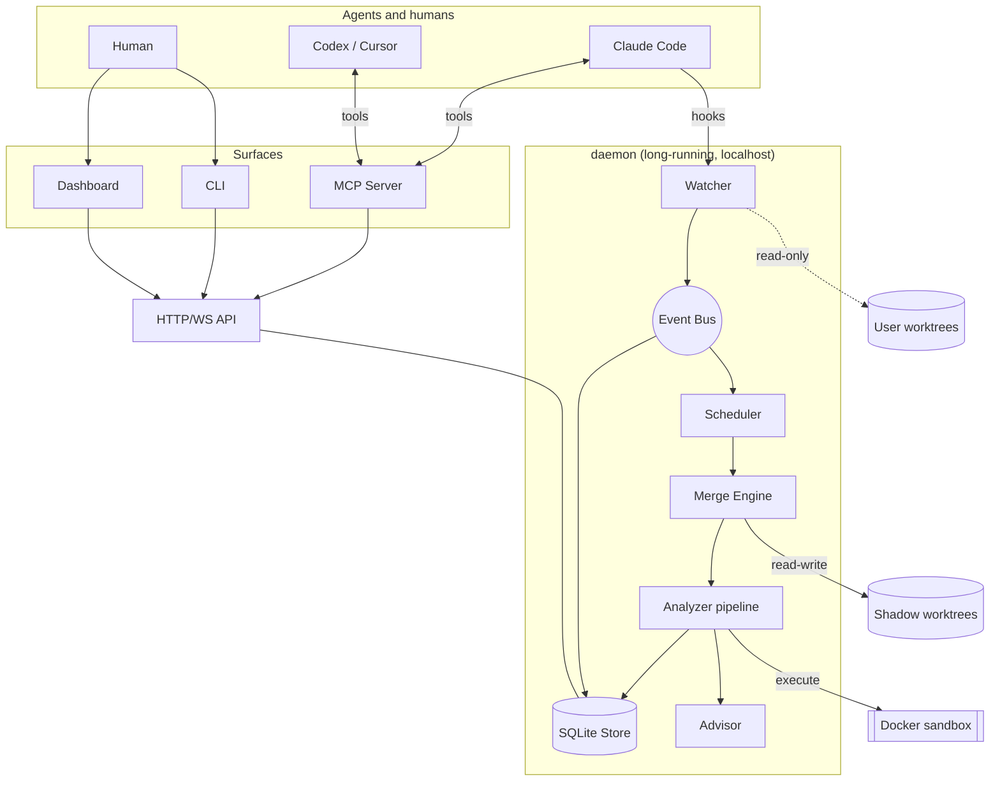

# Architecture

> Structural changes update this file in the same PR.

## The shape of the system

Two edges carry the security posture: the dotted edge to user worktrees is read-only, and everything executed runs inside the sandbox.

The sandbox is a fresh container per command, created with `--pull=never` and removed on every path. The merged tree is mounted read-only at `/work` and dependencies read-only beneath it; a tmpfs at `/tmp` takes every write and disappears with the container, so nothing a command writes is ever read back by the host. It has no network and no capabilities, runs as the daemon's own uid — never root — and is held to CPU, memory, process and wall-clock limits. A command that exits non-zero is a result for its analyzer to judge; a limit firing or Docker being unreachable is an infrastructure error, never a verdict on the code.

## Package map

| Package                 | Role                                                  | Depends on                      |
| ----------------------- | ----------------------------------------------------- | ------------------------------- |
| `@interlock/shared`     | models, events, config, errors, logging, ids          | nothing                         |
| `@interlock/core`       | git/shadow ops, speculative merge, analyzers, ranking | shared                          |
| `@interlock/daemon`     | watcher, bus, scheduler, store, API, composition root | shared, core                    |
| `@interlock/mcp-server` | agent-facing tools                                    | shared (+ daemon API over HTTP) |
| `@interlock/cli`        | `interlock` command                                   | shared (+ daemon API over HTTP) |
| `@interlock/dashboard`  | React UI                                              | shared (+ daemon API over HTTP) |

Dependencies point one way. `shared` imports no sibling; `core` never imports a runtime package. Both are enforced in `eslint.config.js`.

## Lifecycle of a Finding

The path to trace when debugging anything:

1. **Edit.** An agent writes to a file in a worktree.
2. **Observe.** The watcher sees the filesystem event, debounces, publishes `worktree.changed`.
3. **Snapshot.** The dirty tree is captured without touching the user's index — a temporary index file plus `write-tree` — and its objects are written into the shadow clone's store, never the user's. Publishes `branch.snapshot`, naming the tree and the head it was captured against.
4. **Schedule.** Once the branch has been quiet for the debounce, or at a ceiling if it never is, every pair containing it is marked stale and runs in flight for those pairs are told to discard their results. Pairs whose changes have nothing in common are never merged; the rest are ranked by file overlap and admitted up to the concurrency limit, and a pair already analysed at the same content is not merged again. Publishes `pair.scheduled`.
5. **Merge.** Both sides' commits — real or snapshot — are merged with `git merge-tree` inside the shadow clone's object database. No checkout, no working directory. Publishes `run.merge-completed`.
6. **Analyze.** A conflicted merge is already a textual finding. A clean merge is a semantic candidate: the pre-filter asks whether the two branches touched overlapping exported symbols, and only then is the merged tree materialised — into the pair's slot in a small pool of persistent worktrees, updated by delta so incremental compiler state survives between checks — and handed to the compiler, then to the build and targeted tests inside the sandbox. The compiler is Interlock's own TypeScript, hosted as a language service in a worker thread of the daemon, one per hot slot, so a slot's second check costs its change rather than its repository; it loads no plugin, sees only the files the merged tree lists — not whatever else the slot keeps — and reads nothing outside them, the dependency checkout's `node_modules` and its own `lib` files. A check that runs past its deadline is asked to stop where it stands, keeping its warm state, and its worker is terminated only if it does not. The daemon runs every analyzer in the pipeline in order, each verdict cached under its own analyzer's fingerprint and the run keyed on all of them. Each step publishes `run.analyzer-completed`.
7. **Attribute.** Each problem is traced to which side introduced which half — the difference between "TS2304" and "your rename broke a call site the other branch added".
8. **Record.** Findings are persisted with evidence: spans on both branches, each in that branch's own file; for a textual conflict, the merge it came from — both commits, the merge base and git's conflict type; redacted tool output; symbol trails. Publishes `finding.raised`.
9. **Advise.** The advisor ranks by severity × confidence and produces Advice within the noise budget.
10. **Deliver.** MCP pushes to the owning agent, rate-limited; the dashboard updates over WebSocket; `interlock status` shows it. Publishes `advice.delivered`.
11. **Invalidate.** Branches move; the pair is re-verified, and a finding the next run does not reproduce ends `resolved`. A finding a person dismissed is held to the content it was dismissed at: found again with each side's file unchanged it raises nothing, and once either side's file changes, or the conflict stops reproducing, the dismissal ends and a later return is a new finding.

Every step publishes an event with a `causedBy` pointer, so a Finding can be walked back to the edit that caused it.

`interlock check` runs this path on demand for one named pair, through the daemon, which is the only writer of the shadows and the store. `POST /api/repos/:id/check` runs a watcher pass over the repository first, so the pair is judged on what is on disk now and a branch made a moment ago can be named; plans the pair whatever its overlap; queues it ahead of everything else, past any backoff; and waits for the run launched from that request, up to a deadline the caller sets, asking again if a side moves under it. It answers with the pair's open Findings read from the store, not with what the run did: a run that merges nothing because the content was already judged is still an answer. It is the API's second write route, beside the session hook, and takes the same token. The answer lists dismissed conflicts that still stand beside the open ones; they leave the pair clean.

`interlock dismiss <finding> --reason wrong|known` records a person's verdict on one open or stale Finding, through `POST /api/findings/:id/dismiss`, the API's third write route, behind the same token. A dismissal is the conflict's identity — rule, pair and path — at its content: each side's blob of the conflicted file, read by branch rather than by position. Reconciliation, which a run and a verdict served from the cache both go through, matches found findings against live dismissals on both, so a cache hit behaves exactly as a run. The dismissal is published as `finding.dismissed`, caused by the finding's own `finding.raised`. `wrong` says the finding is a false positive; `known` says it is real and not worth hearing about again at this content.

The false-positive budget is counted from those dismissals: per UTC hour, analyzer kind and rule, Findings first raised and, of those, how many have since been dismissed as wrong or as known. The counts are written in the transaction that raises or dismisses, and retention never prunes them. `GET /api/budget` and `interlock status` report the last 24 and 168 whole UTC hours, the current one included, each with the instant it starts; the rate is dismissed-as-wrong over raised, and with nothing raised it is no data rather than 0%. Delivery is reported as not measured. The rate is a list of detector bugs to fix and never a threshold: nothing reads it to decide whether to raise a Finding.

Each repository's shadow clone is collected in the retention pass: its refresh and keep refs run beside the checks, it waits up to five minutes for the scheduler to go idle, and only its `repack` and `prune` hold the repository's checks off. `GET /api/repos/:id/collection` serves where that collection is — `idle`, `pinning`, `waiting-for-quiet` or `holding`, with when the phase began — the last finished collection's pause and store sizes, and, while collections fail, the count in a row, the next attempt and the last reason, redacted. It is live state held in memory by the shadow registry and never stored, so a restarted daemon reads as having collected nothing yet. `interlock status` names a repository whose checks are held, warns of a failing collection, and shows the last one's pause; `--json` carries the whole record.

## Where the hard parts live

| Problem                                                    | Lives in                          | Notes                                                                     |
| ---------------------------------------------------------- | --------------------------------- | ------------------------------------------------------------------------- |
| Not melting the CPU with N² pairs                          | `daemon/src/scheduler`            | `notes.md` — debounce, priority, invalidation, budgets                    |
| Snapshotting dirty state without touching the user's index | `core/src/git/worktree.ts`        | temporary index file; objects only                                        |
| Disk cost of shadow worktrees                              | `core/src/git/shadow.ts`          | one clone per repo, shared objects, quota + GC                            |
| Materialising merged trees cheaply                         | `core/src/git/worktree-pool.ts`   | LRU per-pair slots, `reset --hard` rewrites the delta                     |
| Running merged code without trusting it                    | `core/src/sandbox`                | read-only tree, tmpfs writes, limits read from Docker                     |
| Knowing how a tree installs, typechecks and builds         | `core/src/sandbox/toolchain.ts`   | read from objects, never run; links refused                               |
| Type-checking a slot without stalling or trusting it       | `core/src/analyzers/typecheck*`   | a warm service per slot in a worker, reads confined to the tree's listing |
| Telling merge-induced errors from pre-existing ones        | `core/src/analyzers`              | baseline diff across base, both branches and the merge                    |
| Naming which branch broke which half                       | `core/src/analyzers`              | attribution against both ChangeSets                                       |
| Not being ignored by agents                                | `mcp-server` + `core/src/advisor` | ranking + rate limits                                                     |
| Not being an attack surface                                | `shared/src/sanitize.ts`          | untrusted content wrapped as data                                         |

## Data flow invariants

- Models are JSON-serializable and identical across SQLite rows, HTTP responses and MCP payloads.
- The event log is append-only; there is no update or delete path for events.
- Analyzer verdicts are cached on the content they judged: the pair in its own order, each side's tree, the merge base, the shadow clone it was merged in, and the analyzer's fingerprint — its own version, the version of every tool it ran through, and the build of the code that merged, classified and redacted. Any change to content, a lockfile included, is another key, and a changed analyzer or toolchain is a miss. Verdicts that describe the environment rather than the content — an infrastructure failure, a timeout — are never cached.
- Infra failures (`SANDBOX_UNAVAILABLE`, `TOOLCHAIN_UNSUPPORTED`) are never findings.
- A type error is reported against a merge only when the merge causes it. The merge base, each side alone and the merge are checked by the pair's own type-check service in its pool slot, which is cycled through them by `reset --hard` and holds the merge again before it is released. A diagnostic's identity is its code, its file under one name for every path a rename joins it to, its message with the check's own paths taken out, and the text its span covers in the tree's object — never its line. Copies are counted: of each identity, the merge's copies past the most the base, either side, or both sides' additions together explain are merge-induced, and configuration diagnostics are compared apart from file diagnostics. A tree that cannot be checked — dependency files that differ from the installed tree, a configuration error in the base or a side, a type checker that died, ran past its deadline or out of memory — makes the comparison unavailable, never empty. Each tree's report is cached in memory under its tree, the installed dependency tree, the compiler's version and the project, so a side that has not moved is not checked again.
- Toolchain detection executes nothing. It reads `package.json`, lockfiles and tsconfigs out of the shadow's object database by tree id, size-capped, so a symlinked manifest is a refused link rather than a followed one, and answers per capability — install, typecheck, build — saying whether each came from the tree or from the repository's `.interlock.json` override. An override command is carried as an opaque string to the sandbox and is never split or run on the host. What it cannot handle — Bun, Deno, Plug'n'Play, lockfiles that disagree — is `TOOLCHAIN_UNSUPPORTED` with the reason, never a guess.
- A dismissed Finding is written only by dismissing it and by ending its dismissal; a run that read it open before the dismissal landed cannot write it back open. A live dismissal is kept by retention, and its evidence by shadow collection, as an open Finding is.
